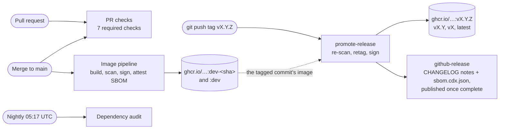
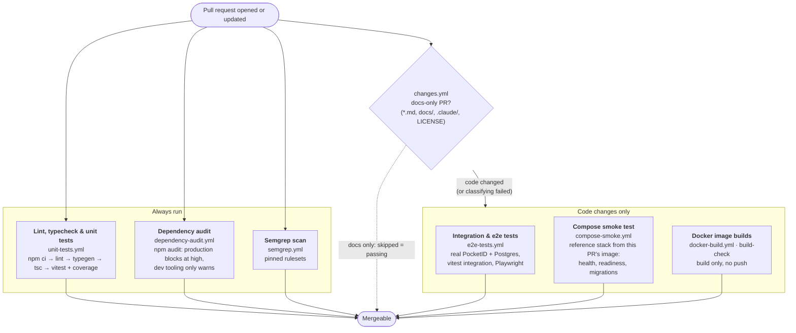
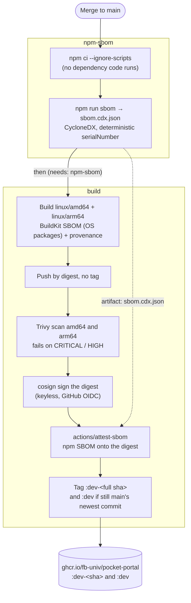
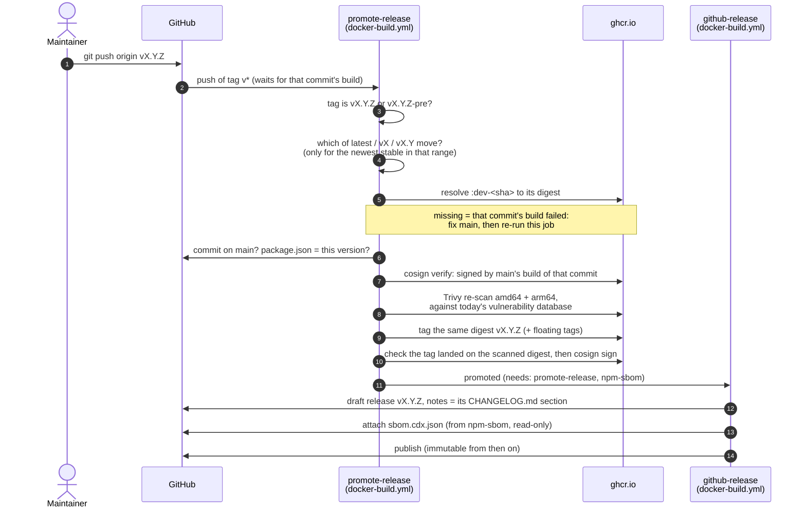

# CI/CD pipelines

What runs when, what it proves, and where to look when it fails. All
workflows live in [`.github/workflows/`](../.github/workflows/); the rules
behind them are in [`git-workflow.md`](../.claude/rules/git-workflow.md),
[`versioning.md`](../.claude/rules/versioning.md) and
[`dependencies.md`](../.claude/rules/dependencies.md).

## Overview

Four things start a pipeline: a pull request, a merge to `main`, a pushed
`vX.Y.Z` tag (which also publishes the GitHub Release), and the nightly
schedule.

On a push to `main`, the same checks as on a PR run again (test, audit, e2e,
compose, Semgrep), next to the image pipeline. CodeQL (GitHub's default
setup, no workflow file) and Dependabot (weekly, 7-day cooldown) run on
their own, and so does the [docs site](#docs-site) build when the docs
change.

## Pull request checks

Every PR runs these, and branch protection on `main` requires all seven
(`Docker image builds` and the two workflows beside it are skipped, which
counts as passing, on a docs-only PR):

Why the docs-only skip goes through `changes.yml` rather than
`paths-ignore`: a required check that never starts blocks the merge
forever, whereas a job skipped by its own `if:` reports as passing.

A newer push to the same PR cancels the PR's runs still in progress.

## Main: the image pipeline

Each merge to `main` builds one multi-arch image, pushed by digest with no
tag, and names it `dev-<sha>` only once it's been scanned, signed and
given its SBOM. Every commit on `main` gets its own concurrency group, so
no later push can cancel or drop its build: every commit needs its own
image, since a release promotes exactly that one. (With one group for all
of `main`, GitHub replaced queued runs, and 11 of 14 merges on Nov 13 got
no image.)

`npm-sbom` holds only `contents: read`; `build` holds the write
permissions (push to GHCR, OIDC for signing, attestations) but installs
nothing from npm itself.

The image is pushed **before** it's scanned (so the scan reads the exact
registry digest), but by digest only: no tag points at it until every
step has passed. A failure anywhere leaves an untagged digest, never an
unscanned `dev-<sha>`, and `dev` on the previous good build. Since builds
of different commits can now run side by side, `dev` moves only if the
commit is still `main`'s newest when its build finishes; otherwise the
newer commit's build moves it.

## Release

A release is a git tag on a commit already built on `main`; nothing is
rebuilt. The steps you run are in
[`versioning.md`](../.claude/rules/versioning.md#process); this is what CI
does with them.

A pre-release (`v1.2.0-rc.1`) gets only its own tag. Version tags never
move once created: `vX.Y.Z` only ever comes from its own git tag, and the
"Release tags are immutable" ruleset stops a `v*` git tag from being moved
or deleted. Published releases are immutable too (repository setting), so
`github-release` attaches the SBOM while the release is still a draft.
`release-sbom.yml` remains only to backfill releases from before that.

## Nightly

`dependency-audit.yml` also runs every night on `main` (and on demand from
the Actions tab), because advisories are published between pushes. A new
high or critical advisory in a production dependency then fails a run named
after the problem, and GitHub emails about the failed scheduled run,
instead of first showing up as unrelated PRs turning red.

## Docs site

`docs.yml` builds `docs/` with VitePress on every PR and push to `main` that
touches `docs/`, `README.md` or the workflow itself, and on `main` publishes
it to GitHub Pages. The docs are their own package (`docs/package.json`,
installed with `--ignore-scripts`), so the app's dependencies never enter
the job; only the `deploy` job holds Pages write permission, and it runs no
dependency code. It isn't a required check: a docs-only break never blocks
an app change.

## Supply-chain guarantees

What a published image carries, and how to check it:

| What | Where | Verify |
| --- | --- | --- |
| Signature | cosign, keyless, tied to this repo's workflow identity. Signed with cosign v3 (new bundle format): verify with **cosign v3 or later**, v2 reports "no signatures found" | `cosign verify ghcr.io/fb-univ/pocket-portal:vX.Y.Z --certificate-identity-regexp '^https://github.com/FB-UNIV/pocket-portal/' --certificate-oidc-issuer https://token.actions.githubusercontent.com` |
| npm SBOM (CycloneDX) | signed attestation on the digest | `gh attestation verify oci://ghcr.io/fb-univ/pocket-portal:vX.Y.Z --owner FB-UNIV --predicate-type https://cyclonedx.org/bom` |
| OS-package SBOM + build provenance | BuildKit attestations in the image index | `docker buildx imagetools inspect ghcr.io/fb-univ/pocket-portal:vX.Y.Z --format '{{json .SBOM}}'` |
| npm SBOM as a file | each GitHub Release's assets | download `sbom.cdx.json` |
| Scan | Trivy at build time, again at release time | the run's log |

Jobs that install dependencies hold no write permission; the steps that
sign, attest or upload run no dependency code. GitHub Actions are pinned to
commit SHAs.

## When a check fails

Start from the run's **Summary** page (the check's "Details" link on the
PR): each workflow writes there why it failed and how to reproduce it.

| Check | Usual causes | Reproduce locally |
| --- | --- | --- |
| Lint, typecheck & unit tests | lint error, type error, failing test, coverage below threshold, `npm ci` failing on a lockfile written by another npm | `npm ci && npm run lint && npx next typegen && npx tsc --noEmit && npm run test:coverage`, on Node 24 |
| Dependency audit | a new advisory in a production dependency; the summary lists package, advisory and fix | `npm audit --omit=dev --audit-level=high` |
| Semgrep scan | a security or correctness pattern; often an action not pinned to a SHA | `docker run --rm -v "$PWD:/src" semgrep/semgrep semgrep scan --config p/typescript --config p/react --config p/security-audit` |
| Integration & e2e tests | PocketID/Postgres didn't start, an integration test, a Playwright test; download the `playwright-report` artifact for traces | `npm run test-env:up`, then `npm run test:integration` / `npm run test:e2e` |
| Compose smoke test | the reference stack isn't healthy, readiness or migrations; the summary has container states and the portal's last logs | `docker compose up -d --wait` with a throwaway `.env` |
| Docker image builds | the multi-stage build or `next build` broke | `docker build -t pocket-portal .` |
| main image build | Trivy found CRITICAL/HIGH in the image (often the base image: bump it), or a signing/attestation step | the run's log; `dev` stays on the previous good build |
| promote-release | tagged before main's build finished (no `dev-<sha>` yet), or the re-scan found something new | re-run the job once the build is green; pushing the tag again does nothing |

Renaming a job changes its check name, and branch protection matches
required checks by name: update the required list in the same change, or
merges block on a check that never reports.
